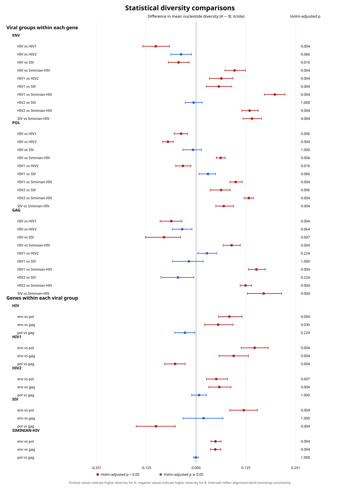

# HIV/SIV conservation comparison

This project collects HIV (Human Immunodeficiency Virus) and Simian Immunodeficiency Virus (SIV) genome sequences to investigate how they are conserved. Downloaded data is stored in Scratch 10 on an HPC. This project was completed for the Supercomputing for Science class at William & Mary. 

### How does nucleotide sequence diversity differ among the gag, pol, and env genes across HIV-1, HIV-2, and SIV, and which genomic regions exhibit the greatest evolutionary conservation?

## Computing Requirement 
Although many of these scripts seem simple a high performance computer is necessary for this to run! Many hours of compute time were used on the bora node of the W&M hpc. This project was competed on the bora node that has 2x Intel Xeon E5-2640 processors, 20 cores per node, 20 nodes, 64 GB of memory, on the 10 GbE/FDR IB network, and was deployed in 2017. 

## Current workflow

The scripts expect the data directories to already be created. Run the 00_setup_file_directory.sh to create them before running the download script. 

```bash
bash scripts/00_setup_file_directory.sh
```

### 1. Download genome data

Submit the batch script:

```bash
sbatch scripts/01_download_data.sbatch
```

It uses NCBI `datasets` to download complete genomes for the configured taxon IDs (11676, 57667, 12721, 35274, 11709, and SIV). The HIV downloads are saved as `HIV1.zip`, `Siminian-HIV.zip`, `HIV.zip`, `HIV3.zip`, and `HIV2.zip`; the SIV download is saved as `SIV.zip`. The ZIP files are saved in their corresponding HIV or SIV Scratch 10 directories. The script's Slurm output and error files are written to the directory from which the job was submitted.

### 2. Unpack the NCBI datasets

After the download job finishes successfully, run:

```bash
bash scripts/02_unpack_data.sh
```

This extracts each archive into its own subdirectory under the matching HIV or SIV directory.

### 3. Remove the ZIP archives

After verifying that the extracted data is present and usable, run:

```bash
bash scripts/03_clean_up_data_folder.sh
```

This permanently removes the downloaded ZIP archives; the extracted directories are retained.

### 4. Create the Conda environment

Run:

```bash
bash scripts/04_create_conda_env.sh
```

The script loads Miniforge and creates or updates the `hiv-comp-env` environment from `hiv-comp-env.yml`, which installs Biopython for reading annotated GenBank files. To activate the environment in a later shell, initialize Conda and activate it:

```bash
module load miniforge3
eval "$(conda shell.bash hook)"
conda activate hiv-comp-env
```

The setup script activates the environment and verifies that Biopython imports successfully after creating or updating it, then deactivates the environment. The pairwise-identity plotting helper uses only Python's standard library, so it does not require an additional plotting package.

### 5. Compare env, pol, and gag

After all six extracted datasets are present and step 4 has created `hiv-comp-env`, submit the comparison job from the project directory:

```bash
sbatch scripts/05_compare.sbatch
```

Wait for this job to finish successfully before proceeding to step 6. `05_compare.sbatch` calls `05_compare.sh`, which runs extraction, alignment, and the pairwise identity summary. Do not submit the comparison again if you have already run it successfully and `results/region_pairwise_identity.csv` exists. If working inside an allocated compute node instead of submitting a job, you can run `bash scripts/05_compare.sh`.

The script extracts annotated `env`, `pol`, and `gag` CDS features from each dataset's `.gbff` files, aligns each region separately with MAFFT, and compares every dataset-group pair. The regions are extracted from the CDS product name: 'envelope', 'gp120', or 'gp160' map to env; 'polymerase' or 'reverse transcriptase' map to pol; and 'core protein' or 'pr55' map to gag. Unmatched regions and fusion areas are skipped. The comparison includes within-group pairs as well as between-group pairs. It requires the extracted directories `HIV/HIV`, `HIV/HIV1`, `HIV/HIV2`, `HIV/HIV3`, `HIV/Siminian-HIV`, and `SIV/SIV` under `~/scr10/data_project`; it stops with an error if a dataset directory or its genome files are missing. MAFFT aligns each region, and `06b_summarize_comparison.py` summarizes the alignments.

Outputs are written to the project `results/` directory:

- `env.fasta`, `pol.fasta`, `gag.fasta`: extracted nucleotide CDS sequences, labeled with their dataset group.
- `env.aln.fasta`, `pol.aln.fasta`, `gag.aln.fasta`: MAFFT alignments.
- `region_sequence_counts.csv`: extracted sequence counts for each region and dataset group.
- `region_pairwise_identity.csv`: sequence-pair counts, alignment lengths, callable and identical site totals, and pooled percent identity for each region and group pair.

Identity is calculated over alignment columns where both sequences have an unambiguous nucleotide (`A`, `C`, `G`, or `T`); gaps and ambiguous bases are excluded. The reported percent identity is pooled across all sequence pairs in each group comparison, not an unweighted average of per-sequence identities. Rows with no available sequence pairs or no callable sites have a blank identity value. Check the extraction warnings and sequence-count table before interpreting comparisons, since datasets may lack a CDS annotation for a region.

### 6. Run pairwise identity comparisons and create the heatmap

This step requires step 4 (the `hiv-comp-env` environment) and successful completion of step 5 (the existing `results/region_pairwise_identity.csv`). If you have already completed both, proceed directly to the plot; do not rerun either step. From the project directory, create the heatmap from the existing CSV:

```bash
bash scripts/07_pairwise_identity.sh
```

If you prefer to submit the plotting step as a small Slurm job, submit the wrapper from the project directory:

```bash
sbatch scripts/07_pairwise_identity.sbatch
```

The script loads Miniforge, initializes Conda in its current shell, activates `hiv-comp-env`, runs `07_plot_pairwise_identity.py` on the existing CSV, and deactivates the environment. The heatmap covers within-group and between-group comparisons for HIV, HIV1, HIV2, HIV3, Siminian-HIV, and SIV.

The plotting step writes `results/region_pairwise_identity_heatmap.svg`, with one heatmap panel per gene. It does not modify the comparison CSVs. Inspect the sequence counts and comparison CSV alongside the heatmap; identity values are pooled over callable nucleotide sites, with gaps and ambiguous bases excluded.


This map shows pairwise identity for the ENV, GAG, and POL regions of the genome. The direct comparisons (e.g. SIV to SIV, HIV to HIV, HIV1 to HIV1...) are group averages not comparisions of each sequence to itself. The summarizer compares every distinct pair of sequences and pools the matching and callable nucleotide sites; gaps and ambiguous bases are excluded. Since sequences vary, those averages are below 100%.

### 7. Create sliding-window diversity and conservation profiles

This step uses the existing MAFFT alignments from step 5 to create the profiles.
```bash
sbatch scripts/08_sliding_window_profiles.sbatch
```

The workflow uses 100 alignment columns per window, with windows advancing by 10 columns. The final window is anchored to the end of each alignment so that
the terminal columns are included; alignments shorter than 100 columns use one window. The bash script calls two python scripts, `08_sliding_window_profiles.py` and `09_plot_sliding_window_profiles.py`

`08_sliding_window_profiles.py` writes `results/sliding_window_profiles.csv`. It reports each observed dataset group separately, plus an `ALL` profile pooled across groups, for env, pol, and gag. Nucleotide diversity (π per site) is the mean per-column fraction of callable sequence pairs that differ. Mean conservation is the average frequency of the most common unambiguous nucleotide at callable columns, and invariant-site percentage is the percentage of columns with at least two callable sequences that agree completely. Gaps and ambiguous bases are excluded. The CSV records the window's alignment-column coordinates and the number of columns usable for each metric; a metric is blank when no sites can be evaluated.

`09_plot_sliding_window_profiles.py` creates six SVGs in `results/`: one nucleotide-diversity and one conservation profile for each of env, pol, and gag. The horizontal axis is alignment-column position, not genomic coordinates. The scripts use Python's standard library and require no additional package.

The six profiles are arranged below in a 2-row by 3-column gallery: columns are env, pol, and gag; the first row shows conservation and the second row shows nucleotide diversity.

<table>
  <tr>
    <td align="center"><strong>ENV conservation</strong><br></td>
    <td align="center"><strong>POL conservation</strong><br></td>
    <td align="center"><strong>GAG conservation</strong><br></td>
  </tr>
  <tr>
    <td align="center"><strong>ENV nucleotide diversity</strong><br></td>
    <td align="center"><strong>POL nucleotide diversity</strong><br></td>
    <td align="center"><strong>GAG nucleotide diversity</strong><br></td>
  </tr>
</table>

### 8. Statistical comparisons of diversity among genes and viral groups

After the aligned FASTA files from step 5 are available, submit the statistical analysis as a Slurm job from the project directory:

```bash
sbatch scripts/10_statistical_diversity.sbatch
```

The script compares mean nucleotide diversity (π per site) between every pair of observed viral groups within each gene, and between every pair of genes within each viral group. It writes estimates, differences (`A - B`), 95% block-bootstrap confidence intervals, two-sided bootstrap p-values, and Holm-adjusted p-values across all comparisons to `results/statistical_diversity_comparisons.csv`. The pooled `ALL` profile is not included as a viral group.

The analysis resamples contiguous blocks of approximately 100 alignment columns with replacement (10,000 replicates by default; random seed 314159). Comparisons between groups within one gene use the same resampled blocks; comparisons between genes use independent block resamples. P-values use a null-centered bootstrap distribution, and Holm adjustment controls the family-wise error rate across the reported comparisons. Gaps and ambiguous bases are excluded from per-site diversity, matching the sliding-window calculation. Groups with fewer than two sequences or fewer than two callable blocks are skipped and reported in the job output.

These intervals and tests measure variation across alignment blocks **conditional on the sequences included in each alignment**; they do not resample the viral sequences and therefore do not quantify uncertainty from sequence sampling. The number of sequences and callable columns for each comparison is included in the CSV. This workflow uses the existing Conda environment and Python standard library.

After the statistical job finishes, create a forest plot from its CSV:

```bash
python scripts/11_plot_statistical_diversity.py
```

The plotter reads `results/statistical_diversity_comparisons.csv` and writes `results/statistical_diversity_forest_plot.svg`. It shows each estimated diversity difference and its 95% block-bootstrap confidence interval; red points indicate Holm-adjusted p-values below 0.05. It does not rerun the analysis or modify the CSV. To use different paths, pass `--input` and/or `--output`.



Each point shows the estimated difference in mean nucleotide diversity (π per site), calculated as **A − B**; the horizontal line is its 95% block-bootstrap confidence interval. Values to the right of zero indicate higher estimated diversity for A, while values to the left indicate higher estimated diversity for B. An interval crossing zero includes no difference among its plausible values.

The upper section compares viral groups within each gene; the lower section compares genes within each viral group. Red points have a Holm-adjusted p-value below 0.05, while blue points do not. The color uses the adjusted p-value, not whether the confidence interval crosses zero, so those two visual cues can differ. For example, the ENV HIV-vs-HIV1 estimate is about −0.101 π/site, indicating lower estimated diversity in HIV than HIV1; it is red because its adjusted p-value is about 0.0045.

Interpret results in the context of the included sequences. The bootstrap resamples alignment blocks, not sequences, so the intervals describe uncertainty across blocks conditional on these alignments and do not capture uncertainty from which viral sequences were sampled. Sample counts are in the CSV's `n_sequences_a` and `n_sequences_b` columns; some groups have small counts, so consult them alongside the plot.

## Personal Reflection 
What started as a whim during the add/drop period at the beginning of the semester has somehow turned into this project! Before this class I didn't even really know what a HPC was, how to fully use my terminal to contorl my computer, wildcards in bash scripts and anything about Git/Github. I had taken Intro to Programming and Data Structures but the hpc seemed very far away. This class and this project has really pushed my limits on how I am using a computer, and even AI tools. If you told me 3 years ago when I entered college that I would be using a 'high performance computer' or even the amount of coding that I am doing I dont think I would have believed you. 

This project started with an idea of comparing HIV and SIV as I worked in a HIV lab this summer looking at how HIV antibodies show up on immunoassays -  how these immunoassays might potentially be used instead of viral load testing as viral load testing is expensive and processing blood sammples for periperal blood mononuclear cells (PBMCs) and plasma. It ended up morphing more into a genomics project with data from NCBI but thats kinda where the initial HIV idea came from. 

I learned a lot as I was completing this project. This class was the first time I had heard of conda (not the snake!) let alone use conda to control what tool versions I am using. I learned to use GitHub to store my work (this project is it's own repository!) in a place where others can see/access the project that I am working on. (You are probably looking at this on Github!) I spent a lot of time figuring out what I was doing for this project, and that is evident in the github pushes, the prompt action log and this README document. 

There were also struggles in this project that are evident purely in the repository. I had reached my space limit on sciclone so I was not able to log in via VS Code to work on this project at one point. I had to troubleshoot what was taking so long and ultimately get rid of 30 GB of temporary git files that were sitting on my home directory from in class when I was attempting to push large directories and it failing. (I've definitely learned my lesson here!)